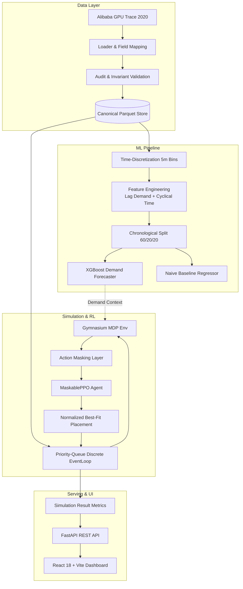

# GridShift Architecture & Systems Design

This document details the architectural decisions, invariant contracts, mathematical formulations, and engineering tradeoffs implemented across **GridShift**.

---

## 1. System Topology

---

## 2. Invariant Contracts

### Resource Capacity Invariants
At all simulation timestamps $t$:
$$\forall m \in \text{Cluster}: \quad \text{alloc}_{m}^{\text{GPU}} \le \text{cap}_{m}^{\text{GPU}}, \quad \text{alloc}_{m}^{\text{CPU}} \le \text{cap}_{m}^{\text{CPU}}, \quad \text{alloc}_{m}^{\text{Mem}} \le \text{cap}_{m}^{\text{Mem}}$$

- Jobs require non-fractional GPU counts ($\text{req\_gpus} \in \mathbb{Z}^+$).
- All three resource dimensions must simultaneously fit on a single physical machine node. Multi-node gang-scheduling is explicitly treated as out-of-scope for the MVP.
- Any allocation attempt that would breach capacity yields an immediate fatal exception in testing and a logged violation event in production.

### Temporal Leakage Prevention
For any forecast sample at window boundary $t$:
$$\text{FeatureSet}(t) \subseteq \text{Events}(\tau \le t)$$
$$\text{Target}(t) = \sum_{j \in \text{Arrivals}(t < \tau \le t + H)} \text{req\_gpus}_{j}$$
Future arrival timestamps, actual execution durations ($\text{observed\_runtime}$), and future completion events are inaccessible to feature extractors and the scheduling policy.

---

## 3. Placement Layer: Normalized Best-Fit

When a policy selects job $j$, candidate machines are filtered by feasibility:
$$\mathcal{M}_{\text{feasible}}(j) = \{m \in \mathcal{M} \mid \text{free}_{m}^{\text{GPU}} \ge j^{\text{GPU}} \land \text{free}_{m}^{\text{CPU}} \ge j^{\text{CPU}} \land \text{free}_{m}^{\text{Mem}} \ge j^{\text{Mem}}\}$$

Among feasible machines, the placement layer minimizes the normalized residual capacity score:
$$\text{Score}(j, m) = \frac{1}{3} \left[ \frac{\text{free}_{m}^{\text{GPU}} - j^{\text{GPU}}}{\text{total}_{m}^{\text{GPU}}} + \frac{\text{free}_{m}^{\text{CPU}} - j^{\text{CPU}}}{\text{total}_{m}^{\text{CPU}}} + \frac{\text{free}_{m}^{\text{Mem}} - j^{\text{Mem}}}{\text{total}_{m}^{\text{Mem}}} \right]$$

A smaller score signifies tighter packing, preserving larger contiguous chunks of idle capacity on other nodes to accommodate future wide jobs and reduce fragmentation.

---

## 4. Reinforcement Learning MDP Formulation

### State Space $S \in \mathbb{R}^{69}$ (for 10 nodes, $K=5$ candidates)
1. **Queue Summary** (4 dims): Normalised waiting length, requested GPU/CPU/Memory backlog.
2. **Top-$K$ Candidates** ($4 \times K$ dims): For each candidate job: $[\text{age}_{\text{norm}}, \text{gpus}_{\text{norm}}, \text{cpu}_{\text{norm}}, \text{mem}_{\text{norm}}]$.
3. **Cluster Node States** ($4 \times N$ dims): Per node: $[\text{free\_gpu}_{\text{norm}}, \text{free\_cpu}_{\text{norm}}, \text{free\_mem}_{\text{norm}}, \text{utilization}]$.
4. **Running Jobs Summary** (3 dims): Aggregate running GPUs, CPU, and running job count.
5. **Demand Forecast Context** (2 dims): Predicted aggregate GPU load for next 30 minutes and forecast age.

### Action Space $A \in \{0, 1, \dots, K\}$
- Actions $0 \le a < K$: Choose candidate job $a$ to schedule immediately.
- Action $a = K$: Choose **WAIT** (let discrete simulation time advance to the next arrival or completion event).

### Feasibility-Based Action Masking
To prevent policy instability and invalid state exploration, `MaskablePPO` queries boolean action masks:
$$\text{Mask}(a) = \begin{cases} \text{True} & \text{if } a < K \land \mathcal{M}_{\text{feasible}}(\text{queue}[a]) \ne \emptyset \\ \text{True} & \text{if } a = K \text{ (WAIT is unconditionally valid)} \\ \text{False} & \text{otherwise} \end{cases}$$

### Step Reward Formulation
$$R = \gamma \cdot N_{\text{completed}} - \alpha \cdot \frac{\sum_{j \in Q} \text{age}_j}{3600 \cdot |Q|} - \delta \cdot \frac{\max_{j \in Q} \text{age}_j}{3600} - \beta \cdot \mathbb{I}(\text{feasible exists}) \cdot \frac{\text{Free GPUs}}{\text{Total GPUs}}$$

- **Completion Reward** ($\gamma = 1.0$): Encourages maximizing cluster throughput.
- **Queue Wait Penalty** ($\alpha = 0.05$): Penalizes keeping jobs waiting.
- **Fairness Penalty** ($\delta = 0.02$): Penalizes extreme tail wait times to discourage job starvation.
- **Idle Backlog Penalty** ($\beta = 0.1$): Penalizes leaving GPU capacity idle when fittable jobs are waiting.

---

## 5. API and Storage Architecture

- **FastAPI** handles asynchronous REST operations.
- **Hybrid Storage Manager** connects to MongoDB with connection pooling via Motor, with an automatic transparent local JSON/Parquet fallback.
- Background simulation tasks run in dedicated worker pools, preventing event loop blocking during long training runs.

