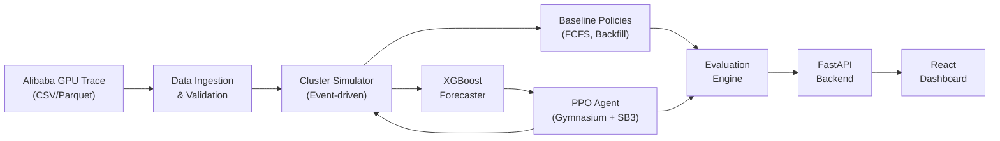
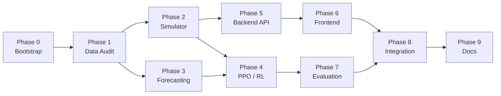

# GridShift — Adaptive GPU Cluster Scheduler
## Complete Implementation Plan (Start → Finish)

> [!IMPORTANT]
> This plan translates every section of the **Adaptive GPU Cluster Scheduler PRD v1.0** into an actionable, phase-by-phase build guide covering backend, ML/DL/AI pipelines, simulation engine, and frontend dashboard.

---

## Table of Contents

1. [Project Overview](#1-project-overview)
2. [Tech Stack & Tooling](#2-tech-stack--tooling)
3. [Repository Structure](#3-repository-structure)
4. [Phase 0 — Project Bootstrapping](#4-phase-0--project-bootstrapping)
5. [Phase 1 — Data Audit & Ingestion (Milestone M1)](#5-phase-1--data-audit--ingestion-milestone-m1)
6. [Phase 2 — Simulator & Baseline Policies (Milestone M2)](#6-phase-2--simulator--baseline-policies-milestone-m2)
7. [Phase 3 — ML Forecasting Pipeline (Milestone M3)](#7-phase-3--ml-forecasting-pipeline-milestone-m3)
8. [Phase 4 — Reinforcement Learning / PPO Policy (Milestone M4)](#8-phase-4--reinforcement-learning--ppo-policy-milestone-m4)
9. [Phase 5 — Backend API Layer](#9-phase-5--backend-api-layer)
10. [Phase 6 — Frontend Dashboard (Milestone M5)](#10-phase-6--frontend-dashboard-milestone-m5)
11. [Phase 7 — Evaluation, Ablations & Experiment Framework](#11-phase-7--evaluation-ablations--experiment-framework)
12. [Phase 8 — Integration, Testing & Polish](#12-phase-8--integration-testing--polish)
13. [Phase 9 — Documentation & Portfolio Packaging](#13-phase-9--documentation--portfolio-packaging)
14. [Risk Register & Mitigations](#14-risk-register--mitigations)
15. [Definition of Done Checklist](#15-definition-of-done-checklist)

---

## 1. Project Overview

**What:** A local, trace-driven simulation platform that replays historical GPU workload traces through a configurable cluster simulator. It trains an XGBoost demand forecaster and a PPO (Proximal Policy Optimization) agent to intelligently schedule jobs, then compares the learned policy against FCFS and backfilling baselines.

**Why:** Portfolio-grade project demonstrating applied ML (time-series forecasting), RL (environment design + PPO training), and systems engineering (event-driven simulation, resource constraints, full-stack dashboard).

**Key Constraint:** This is a *simulation*. No real GPUs are controlled. The RL policy does not need to beat baselines to be successful — a valid, repeatable comparison with honest analysis is the goal.



---

## 2. Tech Stack & Tooling

### Backend & Simulation
| Layer | Technology | Purpose |
|-------|-----------|---------|
| Language | Python 3.11+ | All backend, simulation, ML, RL code |
| API Framework | FastAPI + Uvicorn | REST API for frontend |
| Database | MongoDB (via Motor async driver) | Experiment metadata, configs, metrics |
| File Storage | Local filesystem / Parquet | Trace data, model artifacts, large results |
| Task Runner | Python asyncio / background threads | Long-running experiment execution |

### ML / Forecasting
| Component | Technology |
|-----------|-----------|
| Forecasting Model | XGBoost (xgboost Python package) |
| Feature Engineering | Pandas + NumPy |
| Evaluation Metrics | scikit-learn (MAE, RMSE) + custom WAPE |
| Model Persistence | XGBoost native save / joblib |

### RL / Scheduling
| Component | Technology |
|-----------|-----------|
| RL Environment | Gymnasium (custom `gym.Env`) |
| RL Algorithm | Stable-Baselines3 (PPO) |
| Deep Learning | PyTorch (SB3 backend) |
| Action Masking | SB3-Contrib `MaskablePPO` |
| Checkpointing | SB3 native `.zip` checkpoints |

### Frontend
| Component | Technology |
|-----------|-----------|
| Framework | React 18 + TypeScript |
| Build Tool | Vite |
| Charting | Recharts or Chart.js |
| UI Components | Tailwind CSS + shadcn/ui |
| HTTP Client | Axios or TanStack Query |
| State Management | React Context + TanStack Query cache |

### DevOps & Quality
| Concern | Tool |
|---------|------|
| Package Management | `uv` (Python), `pnpm` (Node) |
| Linting | Ruff (Python), ESLint + Prettier (TS) |
| Testing | pytest (backend), Vitest (frontend) |
| Formatting | Ruff format, Prettier |
| Git Hooks | pre-commit |
| Containerization | Docker + docker-compose (optional) |

---

## 3. Repository Structure

```
GridShift/
├── README.md
├── pyproject.toml                    # Python project config (uv)
├── docker-compose.yml                # MongoDB + optional services
├── .env.example
├── .pre-commit-config.yaml
│
├── data/                             # Raw & processed trace data
│   ├── raw/                          # Original Alibaba trace files
│   ├── processed/                    # Cleaned, canonical Parquet files
│   └── README.md                     # Data provenance & license docs
│
├── src/
│   ├── gridshift/                    # Main Python package
│   │   ├── __init__.py
│   │   ├── config.py                 # Global settings / Pydantic configs
│   │   │
│   │   ├── data/                     # Phase 1: Data ingestion
│   │   │   ├── __init__.py
│   │   │   ├── schemas.py            # Canonical Job, Machine Pydantic models
│   │   │   ├── loader.py             # CSV/Parquet reader + validation
│   │   │   ├── transformer.py        # Field mapping, normalization, filtering
│   │   │   └── audit.py              # Data quality report generation
│   │   │
│   │   ├── simulator/                # Phase 2: Event-driven simulator
│   │   │   ├── __init__.py
│   │   │   ├── cluster.py            # Cluster & Machine state models
│   │   │   ├── event_loop.py         # Discrete-event simulation engine
│   │   │   ├── placement.py          # Best-fit placement + feasibility
│   │   │   ├── policies/             # Scheduling policies
│   │   │   │   ├── __init__.py
│   │   │   │   ├── base.py           # Abstract policy interface
│   │   │   │   ├── fcfs.py           # Strict FCFS
│   │   │   │   ├── backfill.py       # FCFS with backfilling
│   │   │   │   └── ppo_policy.py     # PPO policy wrapper (Phase 4)
│   │   │   └── metrics.py            # Runtime metric collection
│   │   │
│   │   ├── forecasting/              # Phase 3: XGBoost forecaster
│   │   │   ├── __init__.py
│   │   │   ├── features.py           # Lag, context, time feature engineering
│   │   │   ├── splitter.py           # Chronological train/val/test split
│   │   │   ├── trainer.py            # XGBoost training + naive baseline
│   │   │   ├── evaluator.py          # MAE, RMSE, WAPE + error plots
│   │   │   └── predictor.py          # Runtime forecast inference
│   │   │
│   │   ├── rl/                       # Phase 4: PPO training
│   │   │   ├── __init__.py
│   │   │   ├── env.py                # Custom Gymnasium environment
│   │   │   ├── observation.py        # Observation space builder
│   │   │   ├── reward.py             # Reward function components
│   │   │   ├── action_mask.py        # Feasibility-based action masking
│   │   │   ├── trainer.py            # SB3 PPO training loop
│   │   │   └── evaluator.py          # Multi-seed evaluation harness
│   │   │
│   │   ├── evaluation/               # Phase 7: Experiment comparison
│   │   │   ├── __init__.py
│   │   │   ├── experiment.py         # Experiment runner & config
│   │   │   ├── comparator.py         # Side-by-side policy comparison
│   │   │   ├── ablation.py           # Forecast ablation framework
│   │   │   └── export.py             # Results to JSON/CSV for frontend
│   │   │
│   │   └── api/                      # Phase 5: FastAPI backend
│   │       ├── __init__.py
│   │       ├── main.py               # FastAPI app factory
│   │       ├── routes/
│   │       │   ├── datasets.py       # POST /datasets/import, GET /datasets
│   │       │   ├── experiments.py    # CRUD + run experiments
│   │       │   └── forecasts.py      # Forecast results endpoints
│   │       ├── models.py             # API request/response schemas
│   │       └── dependencies.py       # DB connections, shared state
│   │
│   └── scripts/                      # CLI entry points
│       ├── ingest.py                 # Data ingestion CLI
│       ├── simulate.py              # Run simulation from CLI
│       ├── train_forecast.py        # Train XGBoost from CLI
│       ├── train_ppo.py             # Train PPO from CLI
│       └── evaluate.py              # Run full evaluation from CLI
│
├── frontend/                         # Phase 6: React dashboard
│   ├── package.json
│   ├── tsconfig.json
│   ├── vite.config.ts
│   ├── tailwind.config.ts
│   ├── src/
│   │   ├── App.tsx
│   │   ├── main.tsx
│   │   ├── api/                      # API client + hooks
│   │   │   ├── client.ts
│   │   │   └── hooks.ts
│   │   ├── components/               # Reusable UI components
│   │   │   ├── layout/
│   │   │   ├── charts/
│   │   │   └── common/
│   │   ├── pages/                    # Dashboard screens
│   │   │   ├── Overview.tsx
│   │   │   ├── WorkloadExplorer.tsx
│   │   │   ├── Simulation.tsx
│   │   │   ├── Forecast.tsx
│   │   │   ├── Experiments.tsx
│   │   │   └── JobDetails.tsx
│   │   ├── types/                    # TypeScript interfaces
│   │   └── utils/
│   └── index.html
│
├── tests/
│   ├── unit/
│   │   ├── test_schemas.py
│   │   ├── test_loader.py
│   │   ├── test_placement.py
│   │   ├── test_simulator.py
│   │   ├── test_policies.py
│   │   ├── test_features.py
│   │   ├── test_env.py
│   │   └── test_reward.py
│   ├── integration/
│   │   ├── test_ingestion_pipeline.py
│   │   ├── test_simulation_run.py
│   │   └── test_api_endpoints.py
│   └── conftest.py                   # Shared fixtures, mini traces
│
├── notebooks/                        # Exploratory analysis
│   ├── 01_trace_exploration.ipynb
│   ├── 02_feature_engineering.ipynb
│   ├── 03_forecast_analysis.ipynb
│   ├── 04_rl_reward_tuning.ipynb
│   └── 05_results_analysis.ipynb
│
└── artifacts/                        # Saved models & experiment results
    ├── forecasting/
    │   └── models/
    ├── rl/
    │   └── checkpoints/
    └── experiments/
        └── results/
```

---

## 4. Phase 0 — Project Bootstrapping

**Goal:** Repository scaffolding, dependency installation, dev environment ready.

### Tasks

- [ ] **0.1** Initialize Git repo with `.gitignore` (Python, Node, data files, model artifacts)
- [ ] **0.2** Set up Python project with `pyproject.toml` using `uv`
  ```
  Dependencies: fastapi, uvicorn, motor, pymongo, pandas, numpy,
  xgboost, scikit-learn, gymnasium, stable-baselines3, sb3-contrib,
  torch, pydantic, python-dotenv, pyarrow, matplotlib
  ```
- [ ] **0.3** Set up frontend project with Vite + React + TypeScript + Tailwind + pnpm
- [ ] **0.4** Configure `docker-compose.yml` for MongoDB
- [ ] **0.5** Set up pre-commit hooks: Ruff, Prettier, ESLint
- [ ] **0.6** Create `.env.example` with configurable paths (data dir, MongoDB URI, API port)
- [ ] **0.7** Verify all dependencies install cleanly; write a trivial smoke test

### Exit Criteria
✅ `uv run pytest` passes a placeholder test  
✅ `pnpm dev` serves a blank React page  
✅ MongoDB is accessible via docker-compose  

---

## 5. Phase 1 — Data Audit & Ingestion (Milestone M1)

**Goal:** Download, inspect, clean, and normalize the Alibaba GPU Trace 2020 into a canonical job schema.

> [!CAUTION]
> Do NOT proceed to simulation or ML until data provenance, field mappings, and exclusions are fully documented. Garbage-in → garbage-out.

### Tasks

#### 1A. Trace Acquisition & Exploration
- [ ] **1.1** Download Alibaba Cluster Trace GPU 2020 from the official repository
- [ ] **1.2** Document dataset license, citation, and terms of use in `data/README.md`
- [ ] **1.3** Explore raw files in a notebook (`01_trace_exploration.ipynb`):
  - Identify available files (job table, instance table, machine table, etc.)
  - Document column names, data types, value ranges, missing-value rates
  - Identify timestamp format and timezone assumptions
  - Determine which fields map to: `job_id`, `submit_time`, `requested_gpus`, `requested_cpu`, `requested_memory`, `observed_runtime`
- [ ] **1.4** Select a manageable time-range subset (e.g., 2–5 days) that has sufficient job volume for training/evaluation

#### 1B. Canonical Schema & Validation
- [ ] **1.5** Define Pydantic models in `schemas.py`:
  ```python
  class CanonicalJob(BaseModel):
      job_id: str
      submit_time: float          # epoch seconds
      requested_gpus: int         # whole number
      requested_cpu: float        # CPU cores
      requested_memory: float     # GB
      observed_runtime: float     # seconds (simulator-only, hidden from policy)
      # Optional metadata fields
  ```
- [ ] **1.6** Build `loader.py` — read CSV/Parquet, handle encoding, dtypes
- [ ] **1.7** Build `transformer.py` — field mapping, unit normalization, filtering:
  - Map source columns → canonical fields
  - Convert timestamps to epoch seconds
  - Normalize CPU/memory units
  - Filter out rows with missing critical fields (log exclusion counts)
  - Exclude jobs requesting 0 GPUs (if present)
- [ ] **1.8** Build `audit.py` — generate a data quality report:
  - Total rows, valid rows, excluded rows with reasons
  - Distribution plots for GPU requests, CPU, memory, runtime
  - Job arrival rate over time
  - Save report as HTML or Markdown

#### 1C. Persistence
- [ ] **1.9** Save cleaned data as Parquet in `data/processed/`
- [ ] **1.10** Write dataset metadata to MongoDB (source file, date range, row counts, schema version)

### Exit Criteria
✅ Canonical job records load reproducibly from Parquet  
✅ Data audit report documents all mappings, exclusions, and distributions  
✅ No ambiguity in field semantics  

---

## 6. Phase 2 — Simulator & Baseline Policies (Milestone M2)

**Goal:** Build a deterministic, event-driven cluster simulator with FCFS and backfilling policies and a best-fit placement layer.

> [!WARNING]
> **Build the simulator FIRST and make it correct.** If the environment has bugs, RL will learn to exploit them. Add PPO only after the simulation passes capacity-invariant tests.

### Tasks

#### 2A. Cluster & Machine Model
- [ ] **2.1** Define `Machine` dataclass:
  ```python
  @dataclass
  class Machine:
      machine_id: str
      total_gpus: int
      total_cpu: float
      total_memory: float
      allocated_gpus: int = 0
      allocated_cpu: float = 0.0
      allocated_memory: float = 0.0
      running_jobs: list[str] = field(default_factory=list)
  ```
- [ ] **2.2** Define `Cluster` class — collection of machines with aggregate stats
- [ ] **2.3** Add resource query methods: `free_gpus()`, `free_cpu()`, `free_memory()`, `can_fit(job)`, `utilization()`

#### 2B. Best-Fit Placement Layer
- [ ] **2.4** Implement `feasibility_check(job, machine) → bool` — checks ALL three resource dimensions
- [ ] **2.5** Implement `best_fit_score(job, machine) → float` — normalized residual capacity score
  ```
  score = weighted_sum(
      (machine.free_gpus - job.gpus) / machine.total_gpus,
      (machine.free_cpu - job.cpu) / machine.total_cpu,
      (machine.free_mem - job.mem) / machine.total_memory
  )
  ```
  Lower residual = better fit (tighter packing)
- [ ] **2.6** Implement `place_job(job, cluster) → machine_id | None` — find all feasible machines, select one with lowest residual
- [ ] **2.7** Write tests: capacity never goes negative, infeasible jobs are rejected, best-fit selects tightest machine

#### 2C. Event-Driven Simulation Engine
- [ ] **2.8** Define event types:
  ```python
  class EventType(Enum):
      JOB_ARRIVAL = "arrival"
      JOB_COMPLETION = "completion"
      SCHEDULING_DECISION = "decision"
  ```
- [ ] **2.9** Build `EventLoop`:
  - Priority queue (min-heap) of `(timestamp, event_type, payload)`
  - Load all job arrivals from canonical trace at init
  - On `JOB_ARRIVAL`: add job to waiting queue
  - On `SCHEDULING_DECISION`: invoke active policy to select + place jobs
  - On `JOB_COMPLETION`: release resources, trigger new scheduling decision
  - Clock advances to next event (no real-time waiting)
- [ ] **2.10** Implement deterministic seeding — same seed + config = same event sequence
- [ ] **2.11** Add simulation state snapshots for timeline visualization

#### 2D. Baseline Scheduling Policies
- [ ] **2.12** Define abstract `SchedulingPolicy` interface:
  ```python
  class SchedulingPolicy(ABC):
      @abstractmethod
      def select_jobs(self, queue, cluster) -> list[SchedulingDecision]:
          """Return ordered list of (job, machine) pairs to start."""
  ```
- [ ] **2.13** Implement **Strict FCFS**:
  - Always consider only the oldest queued job
  - If it fits → place it; if not → do nothing (block the queue)
- [ ] **2.14** Implement **FCFS Backfilling**:
  - Scan queue from oldest to newest
  - Start every job that currently fits (skip ones that don't, continue scanning)
  - Use same best-fit placement for each

#### 2E. Metric Collection
- [ ] **2.15** Implement `SimulationMetrics` collector:
  - **Average job wait** = mean(start_time − submit_time)
  - **P95 job wait** = 95th percentile of wait times
  - **GPU utilization** = allocated_gpu_time / total_available_gpu_time
  - **Throughput** = completed_jobs / simulation_hours
  - **GPU fragmentation** = events where aggregate free GPUs > 0 but no single machine can fit the oldest waiting job
  - **Constraint violations** = count of over-allocations (MUST be 0)
- [ ] **2.16** Save per-job outcomes: job_id, submit_time, start_time, completion_time, assigned_machine, wait_time

### Testing (Critical)
- [ ] **2.17** Test: fixed seed produces identical output across runs
- [ ] **2.18** Test: no machine ever has negative free resources
- [ ] **2.19** Test: no machine ever exceeds its configured capacity
- [ ] **2.20** Test: FCFS blocks correctly when head-of-queue can't fit
- [ ] **2.21** Test: Backfilling skips unfittable jobs and starts later ones
- [ ] **2.22** Test: Every completed job has start_time ≥ submit_time
- [ ] **2.23** Test: Small hand-crafted traces with known-correct outputs

### Exit Criteria
✅ Deterministic simulator with zero capacity violations  
✅ FCFS and Backfilling produce metrics on the trace subset  
✅ All placement and constraint tests pass  

---

## 7. Phase 3 — ML Forecasting Pipeline (Milestone M3)

**Goal:** Train an XGBoost model to predict aggregate GPU demand in the next 30-minute window, evaluated against a naive baseline with no temporal leakage.

### Tasks

#### 3A. Feature Engineering
- [ ] **3.1** Build time-series samples from the canonical trace:
  - Discretize time into intervals (e.g., 5-minute bins)
  - For each bin, compute: total GPU requests submitted, job count, mean job GPU request
- [ ] **3.2** Implement lag features (`features.py`):
  - GPU demand in previous 1, 2, 3, 6, 12, 24 intervals
  - Job arrival count in recent intervals
  - Running aggregate: currently allocated GPUs, queued GPU requests
- [ ] **3.3** Implement context features:
  - Current cluster utilization (if running within simulation)
  - Queue depth and total queued GPU demand
- [ ] **3.4** Implement time features:
  - Hour-of-day (cyclical: sin/cos encoding)
  - Day-of-week (cyclical: sin/cos encoding)
- [ ] **3.5** Target variable: `sum(requested_gpus)` for jobs submitted in the next 30-minute window
- [ ] **3.6** Enforce no-leakage: every feature uses only data available **before** the forecast timestamp

> [!IMPORTANT]
> **No data leakage.** Every feature value at timestamp *t* must be computable using only events from before *t*. Future job arrivals and completion times are forbidden.

#### 3B. Chronological Data Split
- [ ] **3.7** Implement `splitter.py`:
  - Train: first ~60% of time range
  - Validation: next ~20%
  - Test: final ~20%
  - **No random shuffling** — strictly chronological

#### 3C. Model Training
- [ ] **3.8** Implement naive baseline: predict = GPU demand from the same interval in the most recent comparable period (e.g., same hour yesterday, or last interval's value)
- [ ] **3.9** Train XGBoost Regressor on training set, tune on validation:
  - Hyperparameters: `n_estimators`, `max_depth`, `learning_rate`, `subsample`
  - Use early stopping on validation MAE
- [ ] **3.10** Save trained model + training config + feature list

#### 3D. Evaluation
- [ ] **3.11** Evaluate on held-out test set:
  - **MAE** (Mean Absolute Error)
  - **RMSE** (Root Mean Squared Error)
  - **WAPE** (Weighted Absolute Percentage Error)
- [ ] **3.12** Generate error plots:
  - Predicted vs. actual over time
  - Residual distribution
  - Feature importance (XGBoost built-in)
- [ ] **3.13** Compare XGBoost vs. naive baseline on all metrics
- [ ] **3.14** Save evaluation report (JSON + plots)

### Exit Criteria
✅ XGBoost trained and saved with documented hyperparameters  
✅ Chronological test set evaluation shows MAE, RMSE, WAPE  
✅ Comparison against naive baseline documented  
✅ No temporal leakage in features or splits  

---

## 8. Phase 4 — Reinforcement Learning / PPO Policy (Milestone M4)

**Goal:** Build a Gymnasium environment for the scheduling problem and train a PPO agent that selects jobs from the queue using cluster state and forecast features.

### Tasks

#### 4A. Custom Gymnasium Environment
- [ ] **4.1** Create `SchedulingEnv(gymnasium.Env)`:
  - Wraps the event-driven simulator from Phase 2
  - Each `step()` = one scheduling decision point
  - Episode = full replay of a trace subset
- [ ] **4.2** Define **observation space** (`observation.py`):
  ```
  obs = {
      # Queue summary (4 values)
      "queue_size": int,
      "queue_total_gpus": float,
      "queue_total_cpu": float,
      "queue_total_memory": float,

      # Top-K candidate jobs (K × 4 features each)
      "candidates": [age, req_gpus, req_cpu, req_memory] × K,

      # Cluster state (per-machine: free_gpu, free_cpu, free_mem, utilization)
      "cluster_state": [free_gpus, free_cpu, free_mem, util] × N_machines,

      # Running job summary (3 values)
      "running_allocated_gpus": float,
      "running_allocated_cpu": float,
      "running_count": int,

      # Forecast feature (2 values)
      "forecast_gpu_demand": float,
      "forecast_age": float,      # time since forecast was made
  }
  ```
  - Normalize all values to [0, 1] range
  - Pad candidate slots if fewer than K jobs in queue
- [ ] **4.3** Define **action space** (`action_mask.py`):
  - `Discrete(K + 1)` — select candidate index 0..K-1, or K = WAIT
  - Action mask: only feasible jobs (can be placed on ≥ 1 machine) are valid actions
  - WAIT is always valid
- [ ] **4.4** Integrate XGBoost forecast into observation:
  - At each decision point, run the saved forecaster to produce a demand estimate
  - Include forecast value and its staleness in the observation

#### 4B. Reward Design
- [ ] **4.5** Implement reward components (`reward.py`):

  | Component | Formula Concept | Effect |
  |-----------|----------------|--------|
  | Queue-wait penalty | `−α × sum(queue_ages) / max_age` | Discourages long waits |
  | GPU-idle penalty | `−β × (free_gpus / total_gpus)` when queue > 0 | Penalizes idle resources with backlog |
  | Completion reward | `+γ × jobs_completed_this_step` | Rewards throughput |
  | Fairness penalty (optional) | `−δ × max(queue_ages) / max_age` | Prevents starvation |

- [ ] **4.6** Hard constraints enforced via action masking, NOT reward penalties
- [ ] **4.7** Make reward weights configurable via experiment config
- [ ] **4.8** Add reward normalization / scaling utilities

#### 4C. PPO Training
- [ ] **4.9** Set up training with `MaskablePPO` from sb3-contrib:
  ```python
  from sb3_contrib import MaskablePPO

  model = MaskablePPO(
      "MlpPolicy",
      env,
      learning_rate=3e-4,
      n_steps=2048,
      batch_size=64,
      n_epochs=10,
      gamma=0.99,
      verbose=1,
      seed=SEED,
  )
  ```
- [ ] **4.10** Implement training loop with logging:
  - Episodic reward curve
  - Mean wait time per episode
  - GPU utilization per episode
  - Throughput per episode
- [ ] **4.11** Train on chronological training period (same split as forecasting)
- [ ] **4.12** Save checkpoints: model weights, hyperparameters, reward config, training seed, software versions
- [ ] **4.13** Implement multi-seed training for robustness

#### 4D. PPO Evaluation
- [ ] **4.14** Evaluate on held-out test period using deterministic policy
- [ ] **4.15** Run with multiple seeds, report mean ± std of all metrics
- [ ] **4.16** Compare against FCFS and Backfilling on the **exact same** test workload, cluster config, and placement function
- [ ] **4.17** Save per-job outcomes for detailed analysis

### Exit Criteria
✅ Gymnasium environment passes basic sanity checks (reset, step, done)  
✅ PPO trains without crashing, reward curve shows learning signal  
✅ Checkpoints saved with full reproducibility metadata  
✅ Evaluation on held-out data with multiple seeds  

---

## 9. Phase 5 — Backend API Layer

**Goal:** Build FastAPI endpoints that orchestrate data import, experiment runs, and serve results to the frontend.

### Tasks

#### 5A. API Foundation
- [ ] **5.1** Create FastAPI app with CORS middleware (allow frontend origin)
- [ ] **5.2** Set up MongoDB connection via Motor (async driver)
- [ ] **5.3** Define Pydantic request/response models for all endpoints
- [ ] **5.4** Implement error handling and validation middleware

#### 5B. Dataset Endpoints
- [ ] **5.5** `POST /datasets/import` — Register a trace file, run validation, save metadata:
  ```json
  {
    "file_path": "data/raw/alibaba_gpu_trace.csv",
    "time_range_start": "2020-03-01T00:00:00Z",
    "time_range_end": "2020-03-05T00:00:00Z"
  }
  ```
  Returns: validation summary, row counts, canonical schema version
- [ ] **5.6** `GET /datasets` — List imported datasets with summaries
- [ ] **5.7** `GET /datasets/{id}` — Dataset details, quality report, distributions

#### 5C. Experiment Endpoints
- [ ] **5.8** `POST /experiments` — Create and launch an experiment:
  ```json
  {
    "dataset_id": "...",
    "policy": "fcfs | backfill | ppo",
    "cluster_config": {
      "machines": [{"gpus": 8, "cpu": 64, "memory": 256}],
      "num_machines": 10
    },
    "ppo_config": { "checkpoint": "...", "seed": 42 },
    "forecast_enabled": true
  }
  ```
- [ ] **5.9** `GET /experiments` — List experiments with status (pending/running/completed/failed)
- [ ] **5.10** `GET /experiments/{id}` — Full results: config, aggregate metrics, model references
- [ ] **5.11** `GET /experiments/{id}/jobs` — Per-job outcomes (paginated)
- [ ] **5.12** `GET /experiments/{id}/timeline` — Machine and queue events for visualization

#### 5D. Background Execution
- [ ] **5.13** Run experiments as background tasks (FastAPI BackgroundTasks or asyncio)
- [ ] **5.14** Stream experiment status updates (polling endpoint or SSE)
- [ ] **5.15** Handle experiment failures gracefully, persist partial results

#### 5E. Forecast Endpoints
- [ ] **5.16** `GET /forecasts/{dataset_id}` — Forecast evaluation results, plots data
- [ ] **5.17** `GET /forecasts/{dataset_id}/predictions` — Time-series of predicted vs actual

### Exit Criteria
✅ All endpoints return valid responses with proper error handling  
✅ Experiments can be created, run in background, and results retrieved  
✅ API integration tests pass  

---

## 10. Phase 6 — Frontend Dashboard (Milestone M5)

**Goal:** Build a React dashboard with six screens that let users explore data, run experiments, and compare policy results.

### Tasks

#### 6A. Project Setup & Layout
- [ ] **6.1** Set up React Router with sidebar navigation
- [ ] **6.2** Build responsive shell layout: sidebar + main content area
- [ ] **6.3** Create shared components: loading states, error boundaries, metric cards
- [ ] **6.4** Set up API client with TanStack Query for data fetching + caching

#### 6B. Overview Page
- [ ] **6.5** Display:
  - Cluster configuration summary
  - Active dataset info
  - Latest experiment results (headline metrics)
  - Model status (forecast model trained? PPO checkpoint available?)
- [ ] **6.6** Quick-action cards to navigate to other pages

#### 6C. Workload Explorer Page
- [ ] **6.7** Show imported trace metadata: date range, total jobs, exclusions
- [ ] **6.8** Charts:
  - Job arrival rate over time (line chart)
  - GPU request distribution (histogram)
  - CPU and memory request distributions
  - Missing data summary table
- [ ] **6.9** Interactive time-range selector for filtering

#### 6D. Simulation Page
- [ ] **6.10** Machine cards: per-machine GPU/CPU/memory utilization bars
- [ ] **6.11** Job queue table: waiting jobs with age, requested resources
- [ ] **6.12** Running jobs table: job ID, machine, allocated resources, elapsed time
- [ ] **6.13** Event timeline: scrollable list of scheduling events
- [ ] **6.14** Resource allocation over time (stacked area chart)

#### 6E. Forecast Page
- [ ] **6.15** Time-series chart: predicted vs actual GPU demand
- [ ] **6.16** Error metrics display: MAE, RMSE, WAPE
- [ ] **6.17** Residual distribution chart
- [ ] **6.18** Feature importance bar chart
- [ ] **6.19** Naive baseline comparison table

#### 6F. Experiments Page
- [ ] **6.20** Experiment list table with status badges
- [ ] **6.21** "New Experiment" form:
  - Select dataset, policy, cluster config
  - Configure PPO checkpoint and seed
  - Toggle forecast features
- [ ] **6.22** Side-by-side comparison view:
  - Bar charts comparing: avg wait, P95 wait, GPU utilization, throughput, fragmentation
  - Filter by run, seed, workload slice
- [ ] **6.23** Per-job wait time distribution (CDF or box plot) across policies

#### 6G. Job Details Page
- [ ] **6.24** Searchable/filterable job table
- [ ] **6.25** Job detail panel: submit time, requested resources, wait time, assigned machine, start/completion times
- [ ] **6.26** Job timeline visualization

### Exit Criteria
✅ All six dashboard screens render with real API data  
✅ Experiment comparison charts show meaningful policy differences  
✅ Responsive layout works on desktop screens  

---

## 11. Phase 7 — Evaluation, Ablations & Experiment Framework

**Goal:** Run the full evaluation protocol from the PRD, including ablation experiments and multi-seed comparisons.

### Tasks

#### 7A. Fair Policy Comparison
- [ ] **7.1** Run all three policies on the **same** held-out test workload:
  - Same cluster config (e.g., 10 machines × 8 GPUs × 64 CPU × 256 GB)
  - Same job duration assumptions
  - Same best-fit placement function
  - Same initial conditions (empty cluster)
- [ ] **7.2** Collect all six metrics for each policy:
  - Average job wait, P95 job wait, GPU utilization, throughput, fragmentation, constraint violations
- [ ] **7.3** Run PPO with 5+ random seeds, report mean and std

#### 7B. Ablation Experiments
- [ ] **7.4** **Forecast ablation**: PPO with forecast features vs. PPO without forecast features
  - Train separate PPO checkpoint without forecast in observation
  - Compare on same test workload
  - Document whether forecast adds value
- [ ] **7.5** **Baseline ablation**: FCFS strict vs. FCFS backfill
  - Quantify improvement from queue scanning alone
- [ ] **7.6** **Cluster profile ablation** (optional): Run on different cluster sizes
- [ ] **7.7** **Workload slice ablation** (optional): Test on different time periods

#### 7C. Results Analysis
- [ ] **7.8** Generate comparison tables and charts
- [ ] **7.9** Analyze per-job distributions — check for starvation (don't hide it behind averages)
- [ ] **7.10** Write findings summary: where PPO helps, where it doesn't, and hypotheses for why
- [ ] **7.11** If PPO doesn't beat baselines, document the result honestly (per PRD principle)

### Exit Criteria
✅ All policies compared on identical test conditions  
✅ Forecast ablation completed and documented  
✅ Results include both aggregate metrics and per-job distributions  
✅ Honest analysis of what worked and what didn't  

---

## 12. Phase 8 — Integration, Testing & Polish

**Goal:** End-to-end integration testing, bug fixes, performance optimization, and UX polish.

### Tasks

- [ ] **8.1** End-to-end test: import trace → run baselines → train forecast → train PPO → evaluate → view in dashboard
- [ ] **8.2** Fix any integration bugs between simulator, RL env, and API
- [ ] **8.3** Add loading states and error messages for long-running experiments
- [ ] **8.4** Optimize API response times for large per-job result sets (pagination)
- [ ] **8.5** Add experiment configuration validation (prevent invalid cluster configs)
- [ ] **8.6** Ensure all random seeds are logged and reproducible
- [ ] **8.7** Add progress indicators for training and simulation runs
- [ ] **8.8** Cross-browser testing for dashboard
- [ ] **8.9** Code cleanup: remove dead code, add missing type hints, fix lint warnings

### Exit Criteria
✅ Full workflow runs end-to-end without manual intervention  
✅ Dashboard is responsive and handles errors gracefully  
✅ All tests pass (unit + integration)  

---

## 13. Phase 9 — Documentation & Portfolio Packaging

**Goal:** Make the project portfolio-ready with clear documentation, reproducible setup, and honest results presentation.

### Tasks

- [ ] **9.1** Write comprehensive `README.md`:
  - Project overview and motivation
  - Architecture diagram
  - Quick start: installation, data download, one-command demo
  - Detailed setup instructions
  - How to reproduce experiments
  - Results summary with key charts
  - Limitations and future work
- [ ] **9.2** Document data provenance in `data/README.md`:
  - Source, license, citation
  - Field mappings and exclusions
  - Preprocessing steps
- [ ] **9.3** Add inline code documentation (docstrings for all public functions)
- [ ] **9.4** Create `ARCHITECTURE.md` — system design explanation
- [ ] **9.5** Create `EXPERIMENTS.md` — detailed experiment results, ablation findings, what worked and what didn't
- [ ] **9.6** Add `CONTRIBUTING.md` and `LICENSE`
- [ ] **9.7** Record a demo video or GIF walkthrough of the dashboard
- [ ] **9.8** Tag a release version

### Exit Criteria
✅ A new developer can clone, set up, and reproduce results by following the README  
✅ All claims are backed by documented experiments  
✅ Limitations are stated explicitly  

---

## 14. Risk Register & Mitigations

| # | Risk | Impact | Mitigation |
|---|------|--------|-----------|
| R1 | Trace schema doesn't match expectations | Blocks Phase 1 | Explore raw files first in notebook; have fallback field mappings |
| R2 | Trace license restricts use | Blocks project | Verify license before any implementation; have alternative traces identified |
| R3 | Simulator has bugs that RL exploits | Invalid results | Extensive simulator tests; build + validate baselines before adding RL |
| R4 | Data leakage in features or splits | Inflated metrics | Strict chronological splits; audit feature timestamps; code review |
| R5 | PPO doesn't converge or learn | No RL results | Multiple seeds, reward tuning, simpler observation space; document failure honestly |
| R6 | XGBoost forecast doesn't help PPO | Wasted effort | Run ablation; remove forecast if it doesn't help; document finding |
| R7 | Scope creep (multi-agent RL, live hardware, etc.) | Delays | Strict milestone gates; PRD explicitly excludes these |
| R8 | MongoDB complexity for a student project | Over-engineering | Can fall back to SQLite or JSON files if MongoDB is too heavy |
| R9 | Frontend charting complexity | Delays | Start with simple tables; add charts incrementally |

---

## 15. Definition of Done Checklist

From the PRD, the project is **done** when:

- [ ] ✅ A public workload-trace subset can be imported reproducibly, with provenance, field mappings and exclusions documented
- [ ] ✅ The simulator is deterministic for a fixed seed and passes GPU, CPU and memory capacity-invariant tests
- [ ] ✅ FCFS, FCFS-backfilling and PPO produce repeatable results on matched held-out workloads; PPO checkpoints and run settings are saved
- [ ] ✅ XGBoost is evaluated against a naive forecast baseline without temporal leakage, and the value of forecast features is tested through an ablation
- [ ] ✅ The dashboard exposes workload, forecast, cluster state and policy comparisons
- [ ] ✅ The README documents setup, reproduction steps and limitations

> [!TIP]
> **Remember the PRD's core success definition:** The RL policy does NOT have to beat every baseline. A successful project produces a valid, repeatable comparison and explains where the learned policy helps, where it does not, and why.

---

## Estimated Effort (Rough)

| Phase | Estimated Duration | Dependencies |
|-------|-------------------|-------------|
| Phase 0: Bootstrap | 1 day | None |
| Phase 1: Data Audit | 2–3 days | Phase 0 |
| Phase 2: Simulator + Baselines | 4–5 days | Phase 1 |
| Phase 3: Forecasting | 2–3 days | Phase 1 |
| Phase 4: PPO / RL | 4–5 days | Phase 2, Phase 3 |
| Phase 5: Backend API | 2–3 days | Phase 2 |
| Phase 6: Frontend Dashboard | 4–5 days | Phase 5 |
| Phase 7: Evaluation + Ablations | 2–3 days | Phase 4 |
| Phase 8: Integration + Polish | 2–3 days | All above |
| Phase 9: Documentation | 1–2 days | All above |
| **Total** | **~25–35 days** | |

> [!NOTE]
> Phases 3 and 2 can run partially in parallel since forecasting depends on data (Phase 1) but not on the simulator. Phase 5 (API) can start as soon as Phase 2 has stable interfaces.


