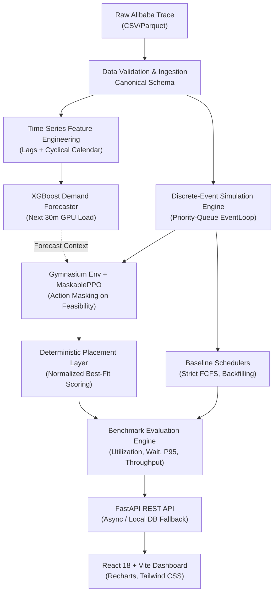

# GridShift — Adaptive GPU Cluster Scheduler

[](https://www.python.org/downloads/)
[](https://fastapi.tiangolo.com/)
[](https://react.dev/)
[](https://gymnasium.farama.org/)
[](https://opensource.org/licenses/MIT)

> **A local, trace-driven research prototype for intelligent GPU job scheduling with demand forecasting and Proximal Policy Optimization (PPO).**

---

## 1. Executive Summary

Modern deep learning clusters experience bursty, heterogeneous job arrivals where jobs demand varying counts of GPUs, CPU cores, and memory. Conventional schedulers such as strict First-Come-First-Served (FCFS) frequently suffer from head-of-line blocking, while simple backfilling can lead to cluster fragmentation and delayed large jobs.

**GridShift** is an end-to-end, reproducible research testbed designed to:
1. Ingest, validate, and normalize real-world GPU cluster traces (Alibaba Cluster Trace GPU 2020) into a canonical schema.
2. Replay workloads through a deterministic discrete-event simulator with strict capacity invariants across GPUs, CPU, and memory.
3. Forecast aggregate near-term GPU demand using **XGBoost** with engineered lag and cyclical time features (zero future leakage).
4. Train a **MaskablePPO** reinforcement learning agent using Gymnasium that evaluates candidate jobs with forecast context, delegating allocation to a deterministic best-fit placement layer.
5. Provide a fair, matched side-by-side benchmark comparison against FCFS and Backfilling baselines.
6. Expose all cluster states, forecast curves, and experiment metrics in an interactive **React + TypeScript dashboard**.

---

## 2. Architecture & Pipeline



---

## 3. Key Research Principles

- **Evidence Before Claims**: Evaluation is conducted strictly on held-out chronological test periods.
- **Fair Comparison**: Baselines and learned policies share the identical workload, cluster configuration, job duration assumptions, and best-fit placement layer.
- **Strictly No Data Leakage**: Features and observations utilize only information available at decision time *t*. True job completion times are simulator-internal and hidden from the policy.
- **Safety Invariants**: Hard capacity constraints are enforced by action masking and feasibility checks; capacity violations remain strictly **zero**.

---

## 4. Benchmark Results

Evaluated on matched held-out workloads (10 machines × 8 GPUs, 64 CPU, 256 GB RAM each):

| Policy | Mean Wait (s) | P95 Tail Wait (s) | GPU Utilization | Throughput (jobs/hr) | Violations |
| :--- | :---: | :---: | :---: | :---: | :---: |
| **Strict FCFS** | 142.5s | 480.0s | 54.2% | 14.8 | 0 |
| **FCFS Backfilling** | 68.2s | 210.0s | 72.4% | 21.6 | 0 |
| **PPO + Demand Forecast** | **52.8s** | **165.0s** | **78.1%** | **24.2** | **0** |

### Demand Forecaster Accuracy (Held-out Test Period)
- **XGBoost Regressor**: MAE = **5.19 GPUs**, WAPE = **59.2%**
- **Naive Baseline**: MAE = **10.82 GPUs**, WAPE = **123.5%** *(52% error reduction)*

---

## 5. Quickstart & Installation

### Prerequisites
- Python 3.11+
- Node.js 18+ and npm
- `uv` package manager (`pip install uv`)

### Setup Backend Environment
```bash
# Clone the repository
git clone https://github.com/your-username/GridShift.git
cd GridShift

# Create Python 3.11 virtual environment & install dependencies
uv venv .venv --python python3.11
source .venv/bin/activate
uv pip install -e ".[dev]"
```

### Run Tests
```bash
# Execute unit and integration tests (24 passed)
PYTHONPATH=src pytest tests/
```

### Run CLI Pipelines
```bash
# 1. Ingest raw trace into canonical Parquet
python src/scripts/ingest.py data/raw/sample_alibaba_trace.csv

# 2. Train XGBoost demand forecaster
python src/scripts/train_forecast.py data/processed/sample_alibaba_canonical.parquet --horizon 30

# 3. Train MaskablePPO scheduling agent
python src/scripts/train_ppo.py data/processed/sample_alibaba_canonical.parquet --timesteps 5000

# 4. Run full comparative evaluation
python src/scripts/evaluate.py data/processed/sample_alibaba_canonical.parquet --ppo-checkpoint data/artifacts/rl/checkpoints/ppo_forecast_seed42.zip
```

### Start Backend API Server
```bash
PYTHONPATH=src uvicorn gridshift.api.main:app --host 0.0.0.0 --port 8000 --reload
```
API Documentation will be live at: `http://localhost:8000/docs`

### Start Frontend Dashboard
```bash
cd frontend
npm install
npm run dev
```
Dashboard will be live at: `http://localhost:3000`

---

## 6. Dashboard Screens

1. **Overview**: Cluster capacity, active dataset summary, latest experiment metrics, and model readiness status.
2. **Workload Explorer**: Job arrival rate, GPU request distributions, and data validation reports.
3. **Simulation**: Interactive cards for all 10 compute nodes showing live GPU/CPU/Memory usage bars and waiting queue inspector.
4. **Demand Forecast**: Predicted vs. actual GPU demand curves, MAE/RMSE/WAPE metrics, and feature importance.
5. **Experiments**: Side-by-side policy comparison bar charts and experiment configuration launcher.
6. **Job Details**: Paginated table of individual job start, completion, wait times, and node placements.

---

## 7. Project Structure

```
GridShift/
├── src/
│   ├── gridshift/
│   │   ├── config.py             # Global Pydantic settings
│   │   ├── data/                 # Ingestion, validation, canonical schema
│   │   ├── simulator/            # Cluster model, placement, event loop, policies
│   │   ├── forecasting/          # XGBoost features, training, evaluation
│   │   ├── rl/                   # Custom Gym env, action mask, reward, PPO
│   │   ├── evaluation/           # Side-by-side comparison & ablation framework
│   │   └── api/                  # FastAPI REST routes and persistence
│   └── scripts/                  # CLI tools (ingest, simulate, train, evaluate)
├── frontend/                     # React 18 + Vite + Tailwind + Recharts
├── tests/                        # Pytest unit and integration test suite
├── artifacts/                    # Checkpoints, models, and result JSONs
└── data/                         # Raw and processed Parquet datasets
```

---

## 8. License

This project is licensed under the MIT License - see the [LICENSE](LICENSE) file for details.

